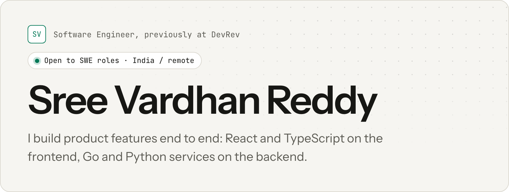
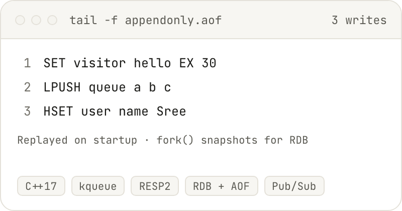
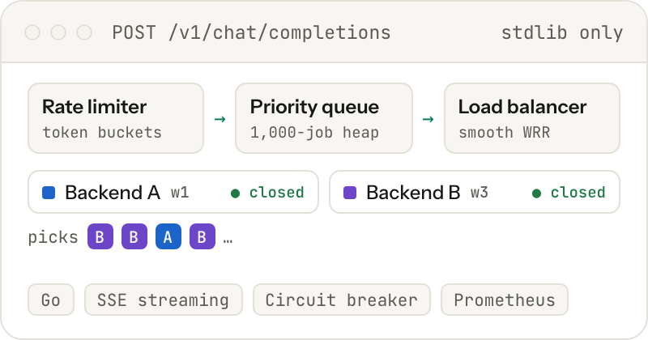
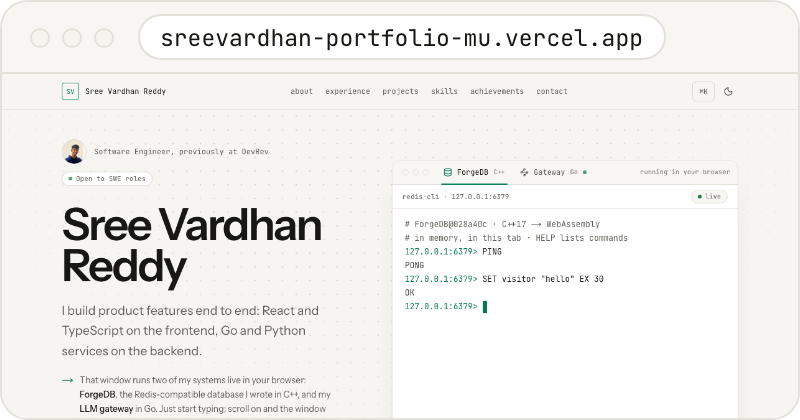
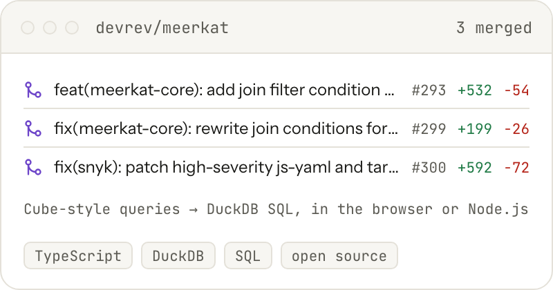
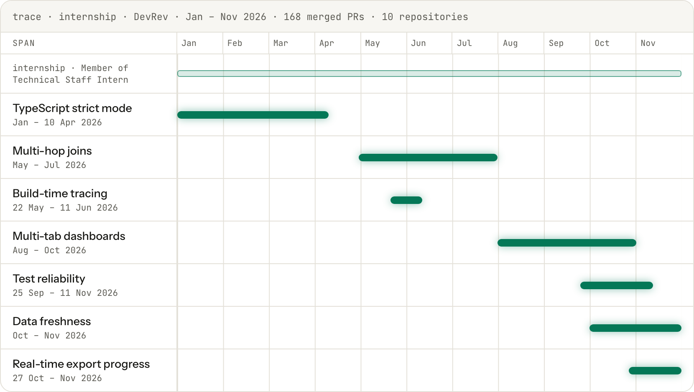
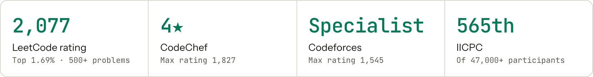

<picture>
  <source media="(prefers-color-scheme: dark)" srcset="assets/header-dark.png">
  
</picture>

  <a href="https://drive.google.com/file/d/12Bx3X4m747QFNTrk2zq8PwqXSHEK5yrS"><picture><source media="(prefers-color-scheme: dark)" srcset="assets/btn-resume-dark.png"></picture></a>
  <a href="https://sreevardhan-portfolio-mu.vercel.app"><picture><source media="(prefers-color-scheme: dark)" srcset="assets/btn-portfolio-dark.png"></picture></a>
  <a href="https://www.linkedin.com/in/sreevardhanreddy/"><picture><source media="(prefers-color-scheme: dark)" srcset="assets/btn-linkedin-dark.png"></picture></a>
  <a href="mailto:itssreevardhan@gmail.com"><picture><source media="(prefers-color-scheme: dark)" srcset="assets/btn-email-dark.png"></picture></a>
  <a href="https://leetcode.com/u/Vardhan1729/"><picture><source media="(prefers-color-scheme: dark)" srcset="assets/btn-leetcode-dark.png"></picture></a>

Previously at [DevRev](https://devrev.ai), where I merged **168 pull requests across 10 repositories** between January and November 2026. Open to full-time backend and full-stack software engineering roles, in India or remote.

<picture>
  <source media="(prefers-color-scheme: dark)" srcset="assets/stack-dark.svg">
  
</picture>

## See it running

<a href="https://sreevardhan-portfolio-mu.vercel.app">
  <picture>
    <source media="(prefers-color-scheme: dark)" srcset="assets/forgedb-demo-dark.svg">
    
  </picture>
</a>

A session recorded from <a href="https://github.com/Sreevardhan1729/ForgeDB">ForgeDB</a>, compiled to WebAssembly and running in my portfolio. <a href="https://sreevardhan-portfolio-mu.vercel.app">Try it live →</a>

## Featured work

<table>
  <tr>
    <td width="50%" valign="top">
      <a href="https://github.com/Sreevardhan1729/ForgeDB"><picture><source media="(prefers-color-scheme: dark)" srcset="assets/card-forgedb-dark.png"></picture></a>
       <b><a href="https://github.com/Sreevardhan1729/ForgeDB">ForgeDB</a></b> · C++17
       A Redis-compatible in-memory database written from scratch. A kqueue event loop serves many clients without locks, and data survives restarts through <code>fork()</code> snapshots and an append-only log.
    </td>
    <td width="50%" valign="top">
      <a href="https://github.com/Sreevardhan1729/ai-inference-gateway"><picture><source media="(prefers-color-scheme: dark)" srcset="assets/card-gateway-dark.png"></picture></a>
       <b><a href="https://github.com/Sreevardhan1729/ai-inference-gateway">AI Inference Gateway</a></b> · Go
       A reverse proxy for LLM APIs using only Go's standard library: weighted load balancing with circuit breakers, per-key rate limiting, a priority queue that sheds batch traffic first, SSE streaming and Prometheus metrics.
    </td>
  </tr>
  <tr>
    <td width="50%" valign="top">
      <a href="https://sreevardhan-portfolio-mu.vercel.app"><picture><source media="(prefers-color-scheme: dark)" srcset="assets/card-portfolio-dark.png"></picture></a>
       <b><a href="https://github.com/Sreevardhan1729/SreeVardhan-Portfolio">Portfolio Lab</a></b> · Next.js, WebAssembly
       Runs both projects in the browser: ForgeDB compiled with Emscripten and the gateway compiled with TinyGo. Fail a backend and watch its breaker open, or burst an API key into 429s. <a href="https://sreevardhan-portfolio-mu.vercel.app">Live →</a>
    </td>
    <td width="50%" valign="top">
      <a href="https://github.com/devrev/meerkat"><picture><source media="(prefers-color-scheme: dark)" srcset="assets/card-meerkat-dark.png"></picture></a>
       <b><a href="https://github.com/devrev/meerkat">Meerkat</a></b> · TypeScript, open source
       3 merged PRs to DevRev's SDK that turns Cube-style queries into DuckDB SQL: <a href="https://github.com/devrev/meerkat/pull/293">join filters for links</a>, <a href="https://github.com/devrev/meerkat/pull/299">a fix for join conditions on aliased bridge tables</a> and <a href="https://github.com/devrev/meerkat/pull/300">a dependency security fix</a>.
    </td>
  </tr>
</table>

## Experience

**Member of Technical Staff Intern, DevRev** · Jan – Nov 2026

Full-stack work on DevRev's dashboards and the data platform behind them.

<picture>
  <source media="(prefers-color-scheme: dark)" srcset="assets/devrev-trace-dark.png">
  
</picture>

- **Real-time export progress** across 6 repositories: a new server-streaming gRPC API, progress events relayed through Temporal, and a progress bar in the desktop app.
- **Per-table data freshness** in Go for the analytics query engine, tracking per-partition Kafka offsets so dashboards show when data was last refreshed.
- **Multi-tab dashboards** in React across 20 PRs, rolled out in 5 feature-flag stages from dev to production GA.
- **dev-instrument**, a build-time tracing loader built on rspack and the TypeScript compiler API. A companion Claude Code skill reads its traces, and it found the root cause of a crash that code review had missed.

**Software Engineer Intern, AlgoUniversity (YC S21)** · Jun – Aug 2025

- Unified scrapers with an auto-tagger that ingested about 2.5k coding problems from 100+ pages, and containerized services on AWS EC2.

**Research Intern, NIT Trichy** · Jun – Oct 2024

- Built a security analytics service whose alerts API reached 97% precision, and a Python ETL pipeline for 2M+ records.

## Stack

- **Languages:** Go, TypeScript, Python, C++, SQL
- **Backend and data:** Kafka, gRPC, Temporal, DuckDB, PostgreSQL, Redis, Django, FastAPI
- **Frontend:** React, Next.js, TanStack Query, Tailwind CSS
- **Infrastructure and testing:** Docker, AWS EC2, GitHub Actions, Prometheus, Playwright, Vitest, GoogleTest

## Competitive programming

<a href="https://leetcode.com/u/Vardhan1729/">
  <picture>
    <source media="(prefers-color-scheme: dark)" srcset="assets/cp-dark.png">
    
  </picture>
</a>

<a href="https://leetcode.com/u/Vardhan1729/">LeetCode</a> · <a href="https://www.codechef.com/users/sreevardhan26">CodeChef</a> · <a href="https://codeforces.com/profile/Vardhan1729">Codeforces</a> · <a href="https://drive.google.com/file/d/1yU8nup-4R4HZvUP_dueMPXehExkszjI-/view?usp=share_link">IICPC certificate</a>

## Education

B.Tech in Computer Science and Engineering, IIIT Kottayam, 2026 · CGPA 9.36
